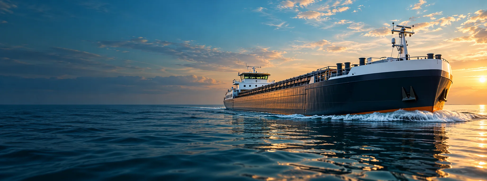
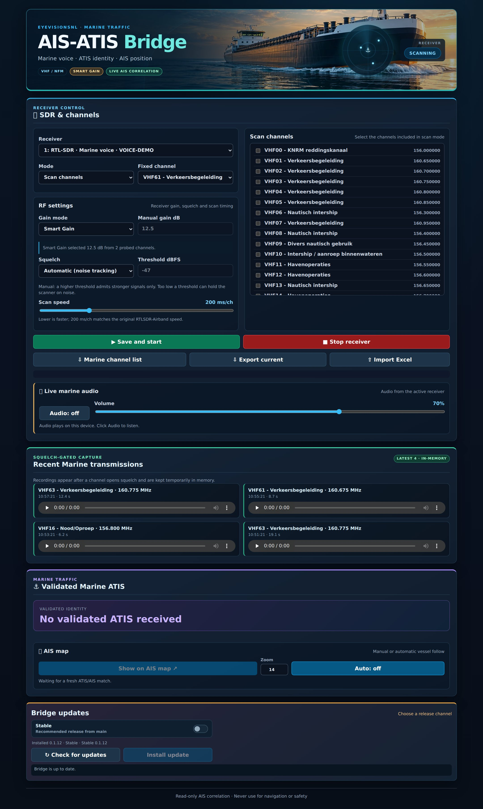

<p align="center">
  
</p>

<h1 align="center">⚓ AIS-ATIS Bridge</h1>

<p align="center">
  <strong>Already receiving AIS? Give that spare SDR something to do!</strong><br>
  Marine VHF · ATIS identification · AIS vessel matching
</p>

<p align="center">
  <a href="https://eyevisionsnl.github.io/AIS-ATIS-Bridge/"><strong>📖 Wiki & guides</strong></a> ·
  <a href="https://eyevisionsnl.github.io/AIS-ATIS-Bridge/installation.html"><strong>🔧 Installation</strong></a> ·
  <a href="https://eyevisionsnl.github.io/AIS-ATIS-Bridge/atis-and-ais.html"><strong>🚢 ATIS & AIS</strong></a> ·
  <a href="https://github.com/EyeVisionsNL/AIS-ATIS-Bridge/issues"><strong>💬 Help & ideas</strong></a>
</p>

## 🚢 Already have AIS-catcher running?

**Your AIS setup already works with its own RTL-SDR — and you have a second, unused RTL-SDR?** That's exactly what AIS-ATIS Bridge is made for.

| Your receivers | What they do |
| --- | --- |
| **RTL-SDR #1 — already in use** | **AIS-catcher** keeps receiving and tracking ships, unchanged. |
| **RTL-SDR #2 — spare receiver** | **AIS-ATIS Bridge** listens to marine VHF and decodes ATIS identities. |

The Bridge reads vessel data from your **existing AIS-catcher** and combines it with received ATIS to show a **Possible Speaker**. It does **not** take over the AIS receiver, install AIS-catcher for you or require the full SDRCC system.

**You need a working AIS-catcher installation and two separate receivers for simultaneous AIS and voice reception.** One dongle cannot do both jobs at once.

## 🎙️ What can it do?

- **Listen or scan** marine VHF channels with live browser audio.
- **Decode and validate ATIS**, then correlate the identity with current AIS vessel data.
- **Show the possible vessel** on the AIS map, with optional automatic following.
- **Replay the four most recent transmissions** (temporary recordings held in memory).
- **Adjust Smart Gain, manual gain and SNR squelch**, and import/export Marine channel lists.
- **Show optional vessel photos** with photographer credit and source links after a validated match.
- **Update from the dashboard** using Stable (`main`) or Beta (`develop`).

A possible speaker is a **correlation, not guaranteed identification**.

## 🖥️ Dashboard preview



*Illustrative preview with example data from an earlier release; the current dashboard may look different.*

## 📚 Wiki — quick guides

| Guide | Go straight to… |
| --- | --- |
| [🔧 Installation](https://eyevisionsnl.github.io/AIS-ATIS-Bridge/installation.html) | Requirements and setup |
| [🔌 First steps](https://eyevisionsnl.github.io/AIS-ATIS-Bridge/first-steps.html) | Selecting your spare receiver |
| [📻 Receiver & channels](https://eyevisionsnl.github.io/AIS-ATIS-Bridge/receiver-and-channels.html) | Scan lists, gain and squelch |
| [🎧 Audio & recordings](https://eyevisionsnl.github.io/AIS-ATIS-Bridge/audio-and-recordings.html) | Live listening and replay |
| [🚢 ATIS & AIS map](https://eyevisionsnl.github.io/AIS-ATIS-Bridge/atis-and-ais.html) | Identity matching and map following |
| [🔄 Updates](https://eyevisionsnl.github.io/AIS-ATIS-Bridge/updates.html) | Stable/Beta and safe updating |
| [🛠️ Troubleshooting](https://eyevisionsnl.github.io/AIS-ATIS-Bridge/troubleshooting.html) | Common reception and setup problems |

**[Open the complete AIS-ATIS Bridge Wiki →](https://eyevisionsnl.github.io/AIS-ATIS-Bridge/)**

## 🚀 Quick installation

Use **Raspberry Pi OS 64-bit or Ubuntu** (documented Ubuntu versions: 24.04/26.04). First check that AIS-catcher already works and provides its vessel feed at `http://127.0.0.1:8119/ships.json` on the same computer.

```bash
git clone --branch main https://github.com/EyeVisionsNL/AIS-ATIS-Bridge.git
cd AIS-ATIS-Bridge
sudo ./install.sh
```

Open `http://<your-device-ip>:8120`, select **RTL-SDR #2** (your spare receiver), choose a channel and start listening. **Leave AIS-catcher and its RTL-SDR #1 running.**

For an existing installation, use **Bridge updates** in the dashboard. [Full installation guide →](https://eyevisionsnl.github.io/AIS-ATIS-Bridge/installation.html)

## 🛰️ Want more than marine radio?

For **AIS, ADS-B, general radio and satellite missions together**, explore our larger project: **[SDRCC — SDR Control Center](https://github.com/EyeVisionsNL/SDRCC)** and its [Wiki](https://eyevisionsnl.github.io/SDRCC/).

## ❤️ Credits, photos & license

The Bridge uses [AIS-catcher](https://github.com/jvde-github/AIS-catcher) vessel data and [RTLSDR-Airband](https://github.com/rtl-airband/RTLSDR-Airband) for voice reception. Its ATIS decoder is derived from [SDRCC](https://github.com/EyeVisionsNL/SDRCC), also maintained by EyeVisionsNL. Independent projects retain their own authors and licenses.

Vessel photos are optional and subject to individual permission or a suitable license. Thanks to photographers and sources including [Mark Prummel](https://markprummel.nl/), [Binnenvaartspotter](https://www.binnenvaartspotter.nl/), [Rensen-Driessen](https://www.rensendriessen.com/building/our-ships/), [Wikimedia Commons](https://commons.wikimedia.org/) and De Binnenvaart. **Photographer credits, original links and watermarks stay intact; approved Rensen-Driessen photos carry its logo.** Permission to display a thumbnail does not grant unrestricted reuse.

**AIS-ATIS Bridge:** [GNU GPL-3.0](LICENSE) · © EyeVisionsNL. **For monitoring and experimentation only — never for navigation or safety decisions.**

[💬 Report an issue](https://github.com/EyeVisionsNL/AIS-ATIS-Bridge/issues) · [📖 Wiki](https://eyevisionsnl.github.io/AIS-ATIS-Bridge/)
